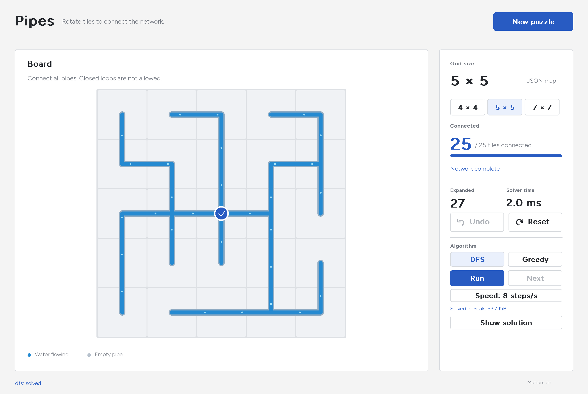

# Introduction to AI

Search algorithms for logic puzzles. This repository currently contains Pipes,
with a Pygame interface, DFS and Greedy Best-First search. Light Up is planned as
the second puzzle.



## Run Pipes

Requires Python 3.13 and [uv](https://docs.astral.sh/uv/). From the repository root:

```sh
uv sync
uv run main.py
```

Rotate tiles to connect every pipe into one network, with no open ends or cycles.
Connected pipes carry animated blue water from the source.

| Control | Action |
|---|---|
| Click / Shift-click | Rotate clockwise / counterclockwise |
| Right-click | Lock or unlock a tile for manual play |
| Undo / Reset | Undo a manual move / restore the starting map |
| DFS / Greedy | Select the algorithm |
| Run / Pause / Next | Play, pause or advance search events |
| Speed / Show solution | Change playback rate / replay a returned solution |
| Motion | Toggle rotation and water animation |

The supported boards are 4×4, 5×5 and 7×7. Run starts from the saved board and
ignores manual moves and locks. An unsolvable map produces an explicit message.

```sh
uv run main.py --map pipes_problem/maps/pipes-4x4-261.json
uv run main.py --size 7 --seed 262
uv run python -m pipes_problem.benchmark
```

Interactive results and batch output are stored automatically under `results/`.
This directory is local and ignored by Git. Maps use only `size`, `source` and
`tiles`, with an optional `reference`. The filename identifies the input.

## Course material

- [Pipes as a search problem](docs/pipes-analysis.md): formulation, legal
  successors, goal test, search space, pseudocode and limitations.
- [Implementation and configuration](docs/pipes-plan.md): maps, playback,
  algorithms, CSV columns and measurement scope.
- [Academic slides](slides/README.md): concise Beamer slides with editable TikZ
  diagrams, compiled PDF and presentation notes.
- [Project handoff](handoff.md): code map, decisions and remaining work.

## Repository layout

```text
pipes_problem/       Game, solvers, tests, configuration and saved inputs
docs/               Analysis, implementation notes and selected benchmark evidence
slides/             Beamer source, PDF and speaker notes
main.py             Pipes launcher
pyproject.toml      Shared Python environment
uv.lock             Locked dependencies
```

Use one repository for the assignment, with a separate package for each puzzle.
Add `light_up_problem/` when implementation begins. Keep puzzle rules and solvers
inside their package; extract shared code only when both games actually need it.

## Checks

```sh
uv sync --frozen
uv run python -m unittest discover -s pipes_problem -t .
uv run ruff check main.py pipes_problem
```

The nine default benchmark inputs are generated examples, not transcriptions
of website puzzles. `maps/custom/cdai.json` is a manually edited unsolvable
example. The analysis distinguishes assignment search steps from manual clicks.

Rules reference: [Pipes](https://www.puzzle-pipes.com/).
Bundled font: Figtree under the [SIL Open Font License](pipes_problem/assets/OFL.txt).
