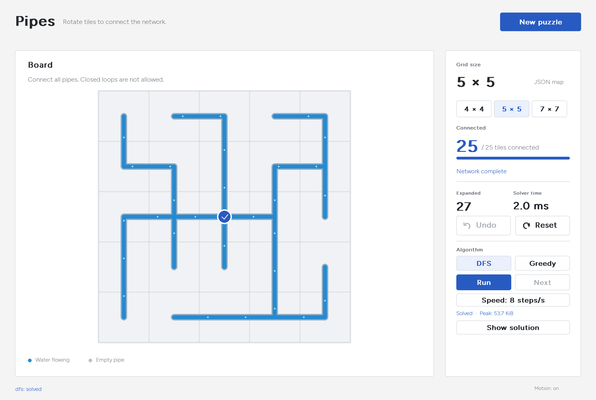

# Introduction to AI — BTL1

Search algorithms for two logic puzzles, implemented in Python 3 with visual
step-by-step demos. This repository contains **Pipes**
([puzzle-pipes.com](https://www.puzzle-pipes.com/), DFS + Greedy Best-First) and
**Light Up / Akari** ([puzzle-light-up.com](https://www.puzzle-light-up.com/),
DFS + A*). Each puzzle ships a pygame game, two solvers (one blind, one
heuristic), automated benchmarks and tests.



## Run

Requires Python 3.13 and [uv](https://docs.astral.sh/uv/). From the repository
root:

```sh
uv sync
uv run main.py          # Pipes (default)
uv run main.py lightup  # Light Up
```

Equivalent module entry points:

```sh
uv run python -m pipes_problem
uv run python -m light_up_problem
```

### Pipes

Rotate tiles to connect every pipe into one network, with no open ends or
cycles. Connected pipes carry animated blue water from the source.

| Control | Action |
|---|---|
| Click / Shift-click | Rotate clockwise / counterclockwise |
| Right-click | Lock or unlock a tile for manual play |
| Undo / Reset | Undo a manual move / restore the starting map |
| DFS / Greedy | Select the algorithm |
| Run / Pause / Next | Play, pause or advance search events |
| Speed / Show solution | Change playback rate / replay a returned solution |
| Motion | Toggle rotation and water animation |

Supported boards are 4×4, 5×5 and 7×7. Run starts from the saved board and
ignores manual moves and locks. An unsolvable map produces an explicit message.

```sh
uv run main.py pipes --map pipes_problem/maps/pipes-4x4-261.json
uv run main.py pipes --size 7 --seed 262
```

### Light Up (Akari)

Place bulbs on white cells so every white cell is illuminated, no two bulbs see
each other along an unobstructed row or column, and every numbered wall has
exactly its count of adjacent bulbs.

| Control | Action |
|---|---|
| Click | Place or remove a bulb |
| Puzzle picker | Choose size (7/10/14/25), difficulty and seed |
| Play manually / Solve | Switch between manual mode and the solver |
| DFS / A* | Select the algorithm (A* returns a minimum-bulb solution) |
| Run / Pause / Step / Stop | Watch the live search, sampled every N events |
| Compare DFS and A* | Run both solvers on the current puzzle once |
| Play solution | Replay the returned bulb placements step by step |

The puzzle picker in the UI selects size, difficulty and seed; puzzles can also
be imported as JSON by the benchmark CLI (`--puzzle-json`, format
`lightup-puzzle-v1`).

```sh
uv run main.py lightup
```

## Benchmarks

Both puzzles record time, peak Python memory (tracemalloc), node counts and
status to CSV. Interactive runs write under `results/` (git-ignored).

```sh
uv run python -m pipes_problem.benchmark        # 9 maps × DFS/Greedy × 5 runs
uv run python -m light_up_problem.benchmark \
  --size 7 --difficulty easy --algorithms dfs astar \
  --repeats 3 --timeout 30 --csv results/benchmark.csv
```

`light_up_problem.benchmark` accepts `--size 7|10|14|25`,
`--difficulty easy|normal|hard`, `--seed`, `--puzzle-json`, `--algorithms`,
`--repeats`, `--timeout`, `--node-limit`, `--memory-limit-mb` and `--csv`.
Published evidence (CSV + summary) lives under
[`docs/benchmarks/`](docs/benchmarks/): `2026-10-25-pipes.*` and
`2026-10-25-lightup.*`, measured on one Linux machine for the course report.

## Report and slides

LaTeX sources build with [tectonic](https://tectonic-typesetting.github.io/)
(one command per file; Vietnamese versions use DejaVu fonts):

```sh
tectonic report/main-vi.tex   # report/main-vi.pdf (tiếng Việt)
tectonic report/main-en.tex   # report/main-en.pdf (English)
tectonic slides/main-vi.tex   # slides/main-vi.pdf (tiếng Việt)
tectonic slides/main-en.tex   # slides/main-en.pdf (English)
```

`slides/main-*.tex` inputs the per-puzzle frame files (`pipes-vi/en.tex`,
`lightup-vi/en.tex`) and `results-table.tex`. Speaker notes are in
[slides/notes.md](slides/notes.md).

## Course material

- [Pipes as a search problem](docs/pipes-analysis.md): formulation, pruning,
  pseudocode, complexity and evaluation design.
- [Light Up as a search problem](docs/lightup-analysis.md): bitmask formulation,
  DFS and the A* lower bound, generation methodology, measurement notes.
- [Implementation notes](docs/pipes-plan.md): Pipes JSON, playback and recording.
- [Project handoff](handoff.md): code map, decisions and remaining work.

## Repository layout

```text
main.py               Launcher: uv run main.py [pipes|lightup]
pipes_problem/        Pipes game, solvers, tests, maps and configuration
light_up_problem/     Light Up game, solvers (bitmask DFS + A*), tests, UI
docs/                 Algorithm analyses, benchmark evidence, images
report/               LaTeX sources of the course report (VI + EN)
slides/               LaTeX sources of the slides (VI + EN)
results/              Local benchmark output (git-ignored)
```

Use one repository for the assignment, with a separate package per puzzle. Keep
puzzle rules and solvers inside their package; extract shared code only when
both games actually need it.

## Checks

```sh
uv sync --frozen
uv run python -m unittest discover -s pipes_problem -t .
uv run python -m unittest discover -s light_up_problem -t .
uv run ruff check main.py pipes_problem light_up_problem
```

The default benchmark inputs are generated examples, not transcriptions of
website puzzles. `maps/custom/cdai.json` is a manually edited unsolvable Pipes
map; Light Up puzzles are generated from seeds with a verified constructive
witness (uniqueness is not checked). Rules references:
[Pipes](https://www.puzzle-pipes.com/) and
[Light Up](https://www.puzzle-light-up.com/).
Bundled font: Figtree under the [SIL Open Font License](pipes_problem/assets/OFL.txt).
